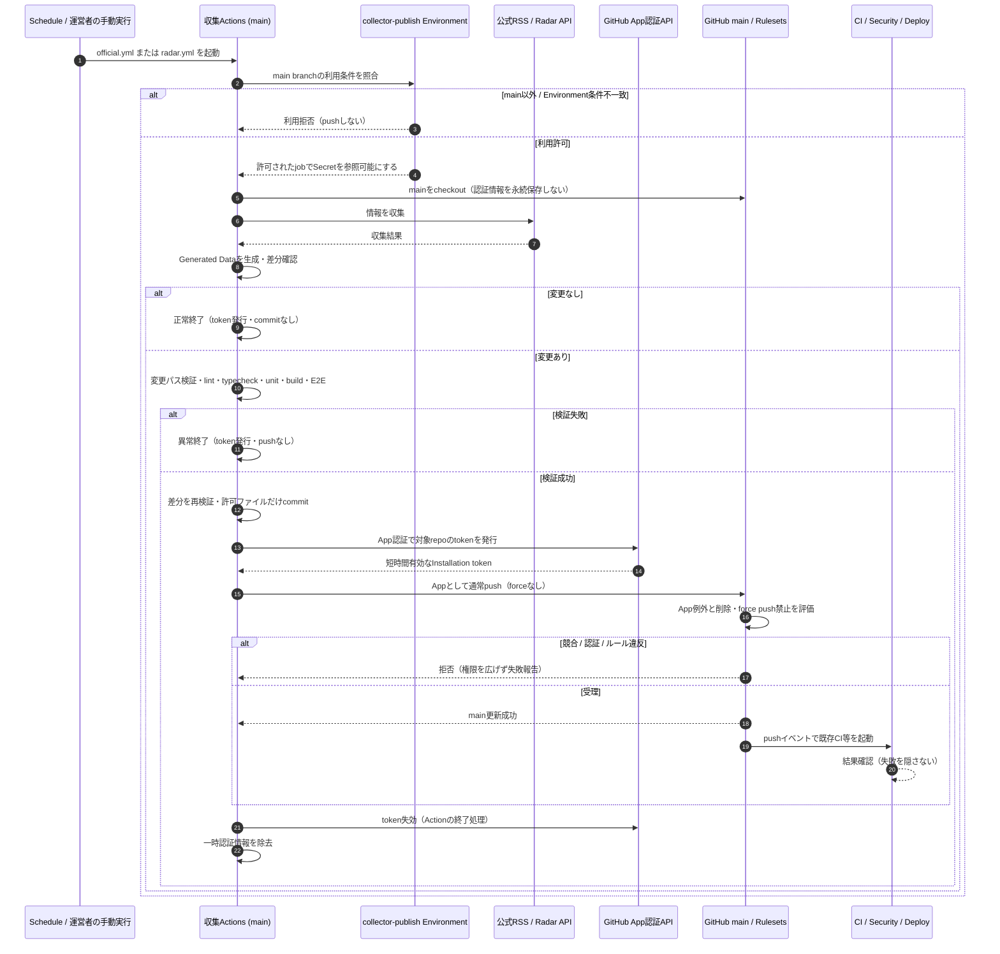
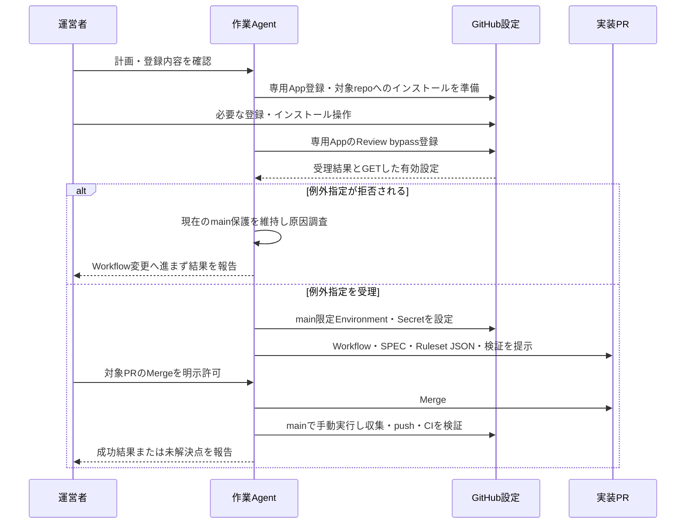

# v2-0005: 収集専用GitHub Appによる自動反映

> **現在の方針（2026-10-22、最新指示）**: ユーザーは非公開での実装再開と、App実動作検証中だけの一時公開を明示承認した。App登録・実装準備後に一時公開し、検証成功・失敗を問わず検証後はいったん非公開へ戻す。その後プラン完了時に正式公開する。対象PRのMergeは個別許可を得る。以下の非公開維持・作業停止記録は以前の判断として保持する。

## 状態と目的

2026-10-22作成。設計段階。App登録、秘密鍵作成、Workflow変更、Ruleset変更、実環境テストは未実施。

他の人のPRは運営者 `@mentamaru` の承認必須とし、公式情報・レーダーの検証済みGenerated Dataだけは毎週自動反映を継続する。GitHub Actionsで処理を実行し、収集専用GitHub AppのInstallation tokenでpushする。新しい常駐サーバー、Database、個人用PATは追加しない。

本計画は公開準備ExecPlan v2-0004に続く新しい実装計画であり、過去の実施記録を書き換えない。今回の依頼範囲は構成・手順・シーケンスの文書化。対象PRへの明示許可なしにMergeしない。

## 現状と問題

- Repositoryはpublic。PR #52はMerge済み。
- `main-protection`（25617456）: mainの削除・force pushを禁止し、bypassなし。
- `main-owner-review`（25617487）: Code Owner承認1件、変更追加時の再承認、Review thread解決を要求。User ID `108460338`だけにPR経由bypass。
- 標準GitHub Actions App ID `15368`をIntegration bypassに登録するAPI要求はHTTP 422で拒否された。実環境にはBot例外がない。
- `.github/workflows/official.yml` / `radar.yml`は標準GITHUB_TOKENでmainへpushするため、新規データがある実行のpushは現状の保護と両立しない。
- `docs/github/main-owner-review.ruleset.json`は拒否されたAppを含む案のまま。実装時に新しい専用AppのIDへ更新する。
- SPECの定期自動反映要件は現状未達。設定を弱めて見かけ上解決しない。

## 構成と責務

| 要素 | 役割・制限 |
| --- | --- |
| 運営者 | App登録・インストールの所有者。人のPRとWorkflow変更をレビューする |
| GitHub Actions | 定期収集、データ差分検証、lint/typecheck/unit/build/E2Eを実行する |
| 収集専用GitHub App | 成功した収集結果をGitHubへ書き込む専用の認証主体。App自身に収集処理をホストしない |
| 専用Environment `collector-publish` | App秘密鍵を保存。利用元はbranchのmainだけ。tagのmainやPR refは許可しない |
| Ruleset `main-owner-review` | 本人のPR経由例外と、専用Appの通常push例外を持つ |
| Ruleset `main-protection` | 本人・専用Appにも削除・force pushを許可しない |
| CODEOWNERS | 全ファイルを `@mentamaru` に割り当て、Workflow・設定変更もレビュー対象とする |

### App登録

- 所有者は `mentamaru`。表示名候補は `mizuho-maru-collector`（空き状況に応じて変更）。名前を認証判定に使わず、登録結果の数値App IDを使う。
- このRepositoryだけにインストールする。他Repositoryや全Repositoryへのアクセスを許可しない。
- Repository permissionは `Contents: read and write` と必須の `Metadata: read`。Administration、Pull requests、Workflows、Secretsのwriteは付与しない。
- Webhook受信やユーザー代理OAuthは使用しない。Webhookは無効とし、受信用サーバーは不要。
- App ID（Ruleset用）、Client ID（token発行Action用）、Installation IDを区別して記録する。秘密鍵やtokenは記録しない。

### 認証・Secret・権限

- Environment variable: `COLLECTOR_APP_CLIENT_ID`。Environment secret: `COLLECTOR_APP_PRIVATE_KEY`。
- 秘密鍵はチャット・Repository・artifact・ログへ貼らない。登録時に安全なローカル一時ファイルからSecretへ直接登録し、登録確認後に不要な作業コピーを削除する。復旧手順は鍵の再発行・旧鍵失効を基本とする。
- Environmentはselected branchesでmainのみ許可する。自動運転を維持するため毎回のRequired reviewerは設定しない。
- 両収集jobでEnvironmentを参照する。main以外の手動実行もjob条件で拒否し、Environment側の制限も併用する。
- 標準GITHUB_TOKENは `contents: read` に下げる。既存Takumi Guardが必要とする `id-token: write` は用途を確認して維持する。
- checkoutは `persist-credentials: false` とし、標準tokenの残留やApp認証との取り違えを避ける。
- 全検証成功・変更ありの場合だけ、GitHub公式 `actions/create-github-app-token` でInstallation tokenを発行する。実装時に採用versionと固定commit SHAを確認し、対象Repository・Contents writeにscopeを絞る。
- App tokenはpush用stepにだけ渡す。remote URLへ埋め込まず、一時的な認証helper等を使用し、tokenを標準出力に出さない。終了時のtoken失効と認証情報の後始末を確認する。
- Radarの `OPENAI_API_KEY` は従来どおり収集stepだけに渡す。App tokenで置き換えるものではない。

### 保護の限界

EnvironmentはWorkflow名を認証条件にしない。mainの別Workflowも同じEnvironmentを指定すればSecretを参照し得る。CODEOWNERSとレビューでその追加を管理する。mainに悪意あるWorkflowが承認されて入った場合まで防げる設計とは説明しない。

同一job内の収集処理や依存パッケージが侵害された場合、後続stepも影響を受け得る。tokenの発行を最後にすることは完全な隔離ではない。既存Takumi Guard、変更パス検証、依存監査、Actionの固定を併用する。Workflowパスに対する暗号学的な限定や外部token発行サービスは今回導入しない。

Contents writeはファイルパス限定の権限ではない。Generated Dataの限定は既存検証処理で強制する。専用AppのbypassもWorkflow単位・変更パス単位ではない。

## 定期実行シーケンス

App tokenによるpushは標準GITHUB_TOKENと異なり後続Workflowを起動し得る。収集Workflow自体にはpush triggerを追加せず、再帰実行を防ぐ。Vercelの実際のDeploy結果も確認し、push成功だけで配信完了としない。

## 導入シーケンスと検証ゲート

### 実装手順

1. 最新main、既存Rulesets、Secretsの名前、収集Workflowを再確認。専用App登録内容を提示し、本人操作が必要なら正確な入力値と手順を案内する。
2. Appを作成・インストールし、App IDを取得。現在のReviewルールを保存してから、User例外を保持して専用Appの `Integration / always` を追加。POST/PUTの受理だけでなくGETで対象・actor・enforcementを確認する。失敗時は現状の保護を維持する。
3. Environment・Secretを用意する。秘密鍵の値を読み戻して検証しない。設定メタデータと認証成功で確認する。
4. 両Workflowへ認証変更を実装する。既存共通concurrency `mizuho-maru-data-collectors` は維持し、collector間の競合を避ける。通常の人のMergeとの競合はnon-fast-forward拒否で停止し、forceや未検証rebaseを行わない。
5. commit authorは専用AppのBot ID/loginを取得してnoreply形式にする。author表示は権限判定とは別であり、push認証が専用Appであることを確認する。
6. SPECの「追加Secret不要」等の記述を、新しいApp認証に必要なSecretと実際の権限に合わせる。既存の収集データ要件は変更しない。Ruleset JSONを実際のApp IDに更新する。
7. PRを作成し検証結果と権限差分を提示。対象PRのMerge許可を得る。
8. main反映後、公式・レーダーを手動実行する。Radarは通常のAPI課金があるため反復実行を最小限にする。新規0件の成功をpush成功の証拠にしない。
9. 実際の新規データがなければpush経路検証は未完了として残す。検証用の記事や空commitを本番mainへ入れない。必要なら運営者とテスト方法を合意する。

## 検証と完了条件

- 実装後に `npm run lint`、`npm run typecheck`、`npm run test:unit`、`npm run build`、必要なE2Eと `git diff --check` を実行する。
- 追加する認証分岐等にLogicがある場合はTDD。変更なし・検証失敗ではtoken発行/pushに到達しないこと、対象外ファイルを拒否することを確認する。既存テストを弱めない。
- Rulesetの有効状態、本人と専用AppだけのReview例外、削除・force pushの例外なし、CODEOWNERSエラーなしをAPIで確認する。
- main以外でEnvironment認証が許可されないことを安全な実行で検証する。別アカウントを用意できない場合、他人の未承認Merge拒否は設定確認にとどまると明記する。
- 専用Appの認証成功と通常push成功、生成ファイル限定、収集後のCI/Security・Deploy結果を確認する。token失効・秘密値のログ非露出も確認する。
- 0件の収集、競合、失敗は区別して記録する。取得できない実行結果を成功と記載しない。
- App例外の受理だけでは完了としない。新規データ反映まで未確認なら未完了項目として残す。

## 障害時・ロールバック

- App認証失敗やpush拒否ではジョブを失敗終了し、PATや本人認証へのfallbackをしない。
- 漏洩の疑いがあればApp秘密鍵を失効し、必要に応じてInstallationを停止、ReviewルールからApp例外を削除する。本人のPR例外・main破壊的更新禁止は維持する。
- 自動反映を止めても公開サイトの既存データは保持される。未反映の収集結果を反映済みと扱わない。
- 自動反映不能時に手動PR方式へ変更する場合は、その仕様変更を運営者へ説明してから行う。

## 予定変更ファイル・依存

- `.github/workflows/official.yml` / `.github/workflows/radar.yml`
- `docs/github/main-owner-review.ruleset.json`
- `SPEC.md` と本ExecPlan、必要なら運用手順文書
- 分岐Logicを追加する場合のみ、それに対応する意味のあるテスト
- npm dependency追加予定なし。GitHub Actionとして `actions/create-github-app-token` を追加予定。

## 根拠

- App認証をActionsで利用: https://docs.github.com/en/apps/creating-github-apps/authenticating-with-a-github-app/making-authenticated-api-requests-with-a-github-app-in-a-github-actions-workflow
- Ruleset bypass: https://docs.github.com/en/rest/repos/rules
- Environment / branch制限: https://docs.github.com/en/actions/reference/workflows-and-actions/deployments-and-environments
- 標準tokenとイベント起動: https://docs.github.com/en/actions/concepts/security/github_token

## 進捗

- [x] 現状・構成・権限・制約・シーケンス・検証手順を文書化
- [ ] App登録・インストールと例外の受理確認
- [ ] Environmentと認証情報の安全な設定
- [ ] Workflow / SPEC / 設定JSONの変更とローカル検証
- [ ] 実装PRへの明示的なMerge許可
- [ ] 本番の通常push・後続CI等の検証
- [ ] 結果記録と未解決項目の確認

### 2026-10-22: ユーザー指示による非公開化

- `gh repo edit mentamaru/mizuho-maru-un-official-fun-site --visibility private --accept-visibility-change-consequences` を実行し、APIで非公開状態を確認。
- 公開・自動化設定の追加作業は停止。再公開は新たな明示指示がある場合のみ実施する。
- 非公開化後のRuleset等の強制状態は再検証していない。公開時の成功記録と区別する。
- この操作はGitHub Repositoryの可視性変更であり、Vercelサイトを非公開にする操作ではない。

## 2026-10-22: 実装再開と一時公開による検証

- ユーザーが実装・動作検証を承認。private/freeではRuleset APIが403、mainはprotected falseで、Environment制限も使えない。Repository Secretへの変更を検討したが、ユーザーは一時公開での検証を選択した。Repository Secret方式は採用しない。
- App登録とローカル検証を先に済ませる。検証直前に一時公開し、main保護・専用App例外の受理を確認してからmain限定Environmentを設定する。公開中の検証が失敗した場合もprivateへ戻し、その状態をGETで確認する。実装PRのMergeは個別承認を必要とする。
- マージ前のApp認証・検証ブランチpushは本番Environmentのmain制限を回避して行わない。安全なローカル認証で一時検証ブランチを作成・SHA確認・削除する。秘密鍵はGit/ログ/チャットへ出さない。mainでの実収集検証は対象PRのMerge許可後に行う。
- 一時検証終了後は非公開へ戻す。private/freeではEnvironmentを使用する収集は利用できない可能性があるため、その期間の自動収集成功を保証しない。正式公開はプラン完了後とし、未検証や未解決を残して完了扱いしない。
- 公式token発行Action v3のSHA `64ab729a6294000f5aa4a4bc0b73d1f32bc45510`を確認して固定。npm依存追加なし。
- 両Workflowにmain限定・Environment・Contents read・checkout認証非永続化・検証後App token発行・App Bot author・共通push helperを追加。
- TDD: push helper未実装時のテスト失敗を確認。main以外・別repo・tokenなしの拒否とpush失敗伝播、tokenがargvへ出ないことをstubで検証する。GitHub実pushとは区別する。
- App登録手順は `docs/github/collector-app-setup.md`。App登録と秘密鍵設定は未実施。Ruleset JSONの旧App IDは専用App ID確定後に置換し、それまでは適用しない。

### 実装ドラフトのローカル検証

- `npm run lint` / `npm run typecheck` 成功（既存4 hints）。`npm run test:unit` は15ファイル138件成功。`npm run build` は7ページ成功。
- YAML parseとmain条件・Environment・token発行順・scope・checkout認証設定の検証成功。`bash -n scripts/push-collector.sh`、`git diff --check` 成功。
- Ruleset JSONから拒否された標準App IDを削除し、本人のPR例外だけにした。専用AppのID確定後、例外を追加する。上記「旧案のまま」の状態はこの変更で解消。
- App登録・実認証・検証ブランチpush・Ruleset例外・収集本番実行は未実施。一時公開もまだ行っていない。
